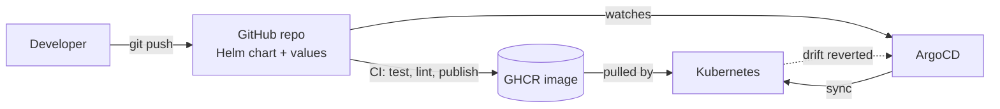

# Random Video Chat App

[](https://github.com/nikhil-flux/sehwas-random-chat-app/actions/workflows/ci.yml)

A random video chat web app (Omegle-style) built with Node.js and Socket.IO, containerised with Docker, served over automatic HTTPS by Caddy, tested and released through GitHub Actions, and deployed to AWS with Terraform.

This project is also my DevOps portfolio piece: the app is the workload, the real work is the delivery pipeline and the infrastructure around it.

## Features

- Random pairing of two users into a chat room
- Live text chat (messages trimmed to 500 characters)
- Report system: users who collect enough reports are temporarily banned by IP
- Health check endpoint wiring so the proxy only starts once the app is healthy

## Architecture

```
 Browser
    |
    |  HTTPS (80 / 443)
    v
+-----------+   reverse_proxy   +-----------------+
|   Caddy   | ----------------> |  Node.js app    |
| auto TLS  |    app:3000       |  (Socket.IO)    |
+-----------+                   +-----------------+
        \                              /
         \____ Docker Compose _______/
                     |
              AWS EC2 (Terraform)
```

## Tech Stack

| Area | Tools |
|------|-------|
| App | Node.js, Express, Socket.IO |
| Containers | Docker, Docker Compose |
| Reverse proxy / TLS | Caddy 2 (automatic HTTPS) |
| CI/CD | GitHub Actions (test and release jobs) |
| Infrastructure as Code | Terraform |
| Cloud | AWS (EC2, Elastic IP, Security Group, optional Budget alert) |

## Project Structure

```
.
├── server.js, public/        # application source (Express + Socket.IO)
├── Dockerfile                # production image
├── docker-compose.yml        # app + caddy services
├── Caddyfile                 # reverse proxy config
├── .env.example              # copy to .env
├── .github/workflows/        # CI (test, helm lint, image publish, release)
├── helm/sehwas/              # Helm chart (values-dev.yaml, values-prod.yaml)
├── argocd/                   # ArgoCD AppProject + dev and prod Applications
├── terraform/                # AWS infrastructure
└── deploy/                   # EC2 helper scripts
```

## Run Locally

Requirements: Docker Desktop.

```bash
git clone https://github.com/nikhil-flux/sehwas-random-chat-app.git
cd sehwas-random-chat-app

cp .env.example .env        # Windows PowerShell: copy .env.example .env
docker compose up --build
```

Open `http://localhost`. Browsers allow camera and microphone on `localhost` without HTTPS.

`SITE_HOST` in `.env` controls the Caddy site address:

| Value | Behaviour |
|-------|-----------|
| `:80` | Plain HTTP, for local testing |
| `chat.example.com` | Caddy gets a Let's Encrypt certificate automatically |

## CI/CD

The workflow in `.github/workflows/ci.yml` runs on every push and pull request:

1. **test**: installs dependencies, runs the tests and SEO check, builds the Docker image
2. **helm**: lints the chart and renders it with the dev and prod values
3. **publish** (main only): pushes the image to GitHub Container Registry as `sha-<commit>` and `latest`
4. **release** (main only): moves the `release` branch to the tested commit

## GitOps with ArgoCD and Helm

Git is the source of truth for what runs in the cluster. ArgoCD watches this repo and keeps the cluster matching it.



| Environment | ArgoCD Application | Git revision | Values |
|-------------|--------------------|--------------|--------|
| dev | `argocd/application-dev.yaml` | `main` | `values-dev.yaml` |
| prod | `argocd/application-prod.yaml` | `release` | `values-prod.yaml` |

Set up (needs a cluster with ArgoCD and an ingress controller installed):

```bash
kubectl apply -f argocd/project.yaml
kubectl apply -f argocd/application-dev.yaml
kubectl apply -f argocd/application-prod.yaml
```

Deploy a change by merging to `main`. Roll back by reverting the commit. Edit the host in `helm/sehwas/values-prod.yaml` before using prod.

The app keeps matchmaking state in memory, so the chart runs a single replica. Scaling out needs shared state first (for example Redis with the Socket.IO Redis adapter).

## Deploy to AWS with Terraform

Requirements: Terraform 1.5+, AWS CLI configured (`aws configure`).

```bash
cd terraform
cp terraform.tfvars.example terraform.tfvars   # optional: set your budget email
terraform init
terraform validate
terraform plan
terraform apply
```

Terraform creates:

- An Ubuntu 24.04 EC2 instance (`t3.micro`, free tier eligible) with 2 GB swap for the Docker build
- A security group for ports 80, 443 (TCP and UDP), and optionally SSH from your IP
- An Elastic IP, so the address survives restarts
- A cloud-init script that installs Docker, clones this repo, writes `.env`, and runs `docker compose up -d --build`
- An optional monthly budget alert

After `apply`, wait about 5 minutes, then open the `site_url` output. With no domain set, the site uses a free `<ip>.sslip.io` name and Caddy gets real HTTPS for it.

| Variable | Purpose | Default |
|----------|---------|---------|
| `aws_region` | AWS region | `ap-south-1` |
| `instance_type` | EC2 size | `t3.micro` |
| `domain` | Your own domain (empty uses sslip.io) | `""` |
| `ssh_cidr` | Your IP for SSH, e.g. `203.0.113.5/32` | `""` (SSH off) |
| `budget_email` | Email for a $5/month cost alert | `""` (skipped) |

Tear everything down when finished:

```bash
terraform destroy
```

## Notes and Limitations

- Video calls may fail between users on strict NATs (mobile data, some campus Wi-Fi) because no TURN server is configured.
- Behind a reverse proxy, client IPs must be read from the `X-Forwarded-For` header for the report and ban feature to work per user.
- Never commit `.env`, `terraform.tfvars`, or `*.tfstate`.

## Author

Nikhil, [@nikhil-flux](https://github.com/nikhil-flux)
